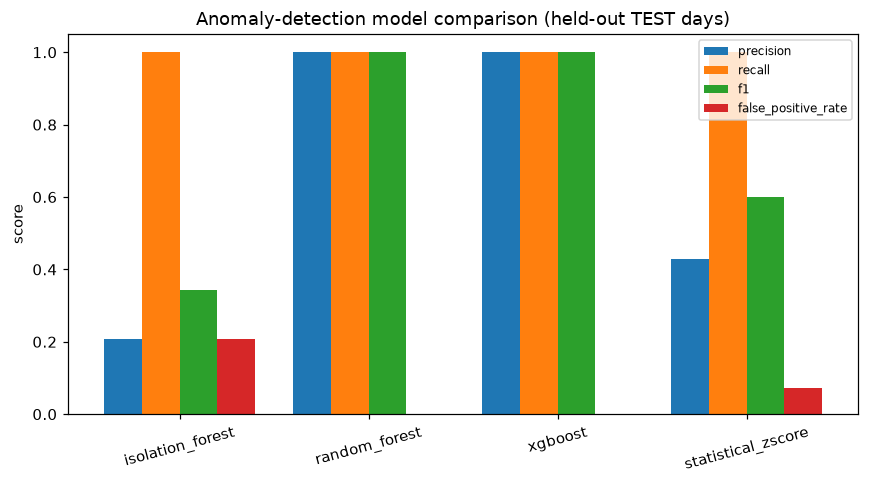
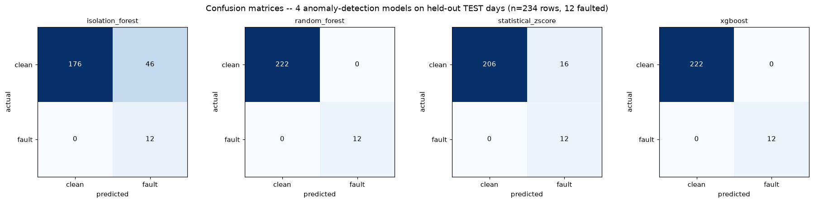
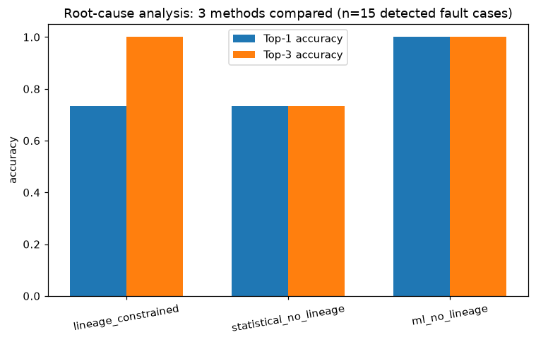
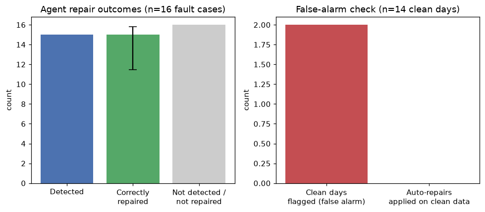

# Evaluation Report

Companion to `RESEARCH_REPORT.md` (methodology, discussion, limitations). This document is the quick-reference tables + figures. Every number here is read from `experiments/results/summary.json`, generated by `scripts/run_research_experiments.py` on 2026-11-25T00:16:36 — reproduce with the command in `DEMO_GUIDE.md` §8.

## Dataset

| | Dates | Days | Rows |
|---|---|---|---|
| TRAIN | 2023-02-01 → 2023-02-28 | 28 | 42,000 |
| TEST (held out) | 2023-03-01 → 2023-03-14 | 14 | 21,000 |

Disjoint by construction and verified (`set(train_days).isdisjoint(test_days) == True`). Source: NYC Socrata open-data API, real trips, not synthetic.

## 1. Anomaly-detection model comparison

| Model | Precision | Recall | F1 | FPR | Latency/row |
|---|---|---|---|---|---|
| Isolation Forest (sklearn) | 0.207 | 1.000 | 0.343 | 0.207 | 9.8 ms |
| Random Forest (sklearn) | **1.000** | 1.000 | **1.000** | **0.000** | 16.6 ms |
| XGBoost | **1.000** | 1.000 | **1.000** | **0.000** | 2.6 ms |
| Statistical z-score baseline | 0.429 | 1.000 | 0.600 | 0.072 | 0.8 ms |

n=234 TEST rows, 12 faulted (duplicate_records, schema_change, join_error; missing_partition excluded by construction — see RESEARCH_REPORT.md §4.4).

**Read this as:** every model catches every fault (recall 1.0 across the board); they differ only on false-positive cost. See RESEARCH_REPORT.md §7.1 for why Isolation Forest's number here isn't the live production detector's number.

## 2. Root-cause analysis comparison

| Method | Top-1 | Top-3 | n |
|---|---|---|---|
| Lineage-constrained (this project) | 0.733 | **1.000** | 15 |
| Statistical, no lineage | 0.733 | 0.733 | 15 |
| ML classifier, no lineage | **1.000** | **1.000** | 15 |

Per fault type (Top-1):

| Fault type | Lineage-constrained | Statistical, no lineage | ML, no lineage |
|---|---|---|---|
| duplicate_records | 1.00 | 1.00 | 1.00 |
| join_error | 1.00 | **0.00** | 1.00 |
| missing_partition | 1.00 | 1.00 | 1.00 |
| schema_change | **0.00** | 1.00 | 1.00 |

**Do not read the headline Top-1 row alone** — see RESEARCH_REPORT.md §6.2 for why the ML-no-lineage classifier's perfect score and the statistical baseline's join_error failure both matter more than the single aggregate number.

GNN decision: not introduced. Existing method already hits 100% Top-3 on a 5-node candidate graph with only 15 labeled cases to train on — no evidence of deficiency, insufficient data to justify one.

## 3. Agent repair performance

| Metric | Value |
|---|---|
| Fault cases | 16 |
| Detected | 15 (93.75%) |
| Repair success rate (overall, detect+repair) | 93.75%, 95% CI [71.7%, 98.9%] |
| Repair success rate (conditional on detection) | 15/15 = 100% |
| Mean detection latency (detector compute only) | 0.245 s |
| Mean recovery time (sandbox verify + apply, 2 real dbt rebuilds) | 29.5 s |

Recovery time by fault type: missing_partition 27.5s, duplicate_records 28.7s, join_error 30.7s, schema_change 30.8s — consistent across types (dominated by fixed dbt rebuild cost).

## 4. False alarms / false repairs

| Metric | Value |
|---|---|
| Clean TEST days checked | 14 |
| Flagged by Isolation Forest (false alarm) | 2 (14.3%) |
| Auto-repairs applied to clean data | 0 (by construction — see RESEARCH_REPORT.md §6.4 for what this number does and doesn't prove) |

## 5. Fifth fault type: transformation_defect (code-level, all days affected)

| Check | Result |
|---|---|
| Detected | Yes |
| RCA Top-1 | Correct (`stg_trips`, `transformation_defect`) |
| RCA Top-3 | Correct |
| Agent correctly refuses to auto-repair | **Yes** |

## 6. Phase 3 agentic-AI checklist

| Capability | Verified against the real system? |
|---|---|
| Receive anomaly alerts | Yes |
| Investigate lineage / pipeline history | Yes |
| Identify likely root cause | Yes (§2 above) |
| Generate repair proposal | Yes, deterministic fallback (no API key available) |
| Execute repair in isolated sandbox after approval | Yes |
| Verify repair restores correct output | Yes |
| Record results | Yes, incident store |
| **Live LLM (`claude-opus-5`) reasoning** | **Not tested — no `ANTHROPIC_API_KEY` configured** |

## Raw data

- `ML_RESULTS.csv` — every (model, arrangement, day) prediction row
- `experiments/results/rca_results.csv` — every (method, arrangement, fault) ranking
- `experiments/results/repair_results.csv` — every agent repair outcome
- `experiments/results/false_alarm_results.csv` — every clean-day flag
- `experiments/results/summary.json` — the aggregated numbers in this document

---

# Hybrid ensemble + XAI evaluation (2026-11-27)

Full method and discussion: [`RESEARCH_REPORT.md` Part II](RESEARCH_REPORT.md#part-ii--hybrid-explainable-anomaly-detection-2026-11-27).
Raw outputs: `experiments/results/hybrid/`. Real NYC TLC 2023 data, chronological splits — train Jan 15–Jun 30
(165 clean days / 294 fault rows), validation Jul–Aug (62 / 105), test Sep–Dec (116 / 142). All thresholds from validation.

## Test results (known faults + clean days)

| Model | Precision | Recall | F1 | FPR | PR-AUC | Unseen-type detection (LOFO) |
|---|---|---|---|---|---|---|
| IsolationForest, live per-batch (previous default) | 0.851 | 0.725 | 0.783 | 0.155 | – | 0.725 |
| Unsupervised ensemble (IF + ECOD + AE, max) | 0.908 | 0.761 | 0.828 | 0.095 | 0.935 | 0.739 |
| XGBoost | 0.922 | 0.838 | 0.878 | 0.086 | 0.955 | 0.218 |
| RandomForest | 0.910 | 0.852 | 0.880 | 0.103 | 0.957 | 0.106 |
| Hybrid weighted | 0.896 | 0.845 | 0.870 | 0.121 | 0.952 | 0.338 |
| **Hybrid gated (selected on validation, now default)** | 0.906 | 0.810 | 0.855 | 0.103 | 0.951 | **0.739** |
| z-score \|z\|>3 (research baseline) | 0.924 | 0.768 | 0.838 | 0.078 | – | 0.768 |

* Hybrid gated beats the previously deployed detector on every metric, keeps 0.739 of its detection on fault
  types it never saw (XGBoost: 0.218), but is **not** better than the simple z-score baseline, which would also
  have won the validation-only selection had it been in the pool (II.4, II.8).
* False alarms concentrate on holidays/weather: 5 of 9 legitimate-event days flagged vs 6.5 % of ordinary days.
* Real source incidents found in the public data (Sep 21–24 volume gap, impossible-trip days): hybrid 6/6.

## Explainability

* Global top-5 (XGBoost mean |SHAP|): trip_count 1.93 > avg_trip_distance_miles 1.37 > avg_fare_amount 1.19 >
  unmatched_zone_count 0.87 > avg_total_amount 0.44.
* Top-1 attributed feature = feature the fault corrupted: SHAP-XGBoost 0.96, LIME-XGBoost 0.95, ECOD 0.91.
* SHAP vs LIME (115 detected faults): top-1 agreement 0.92, top-3 Jaccard 0.58.
* Explanations are feature attributions, not root causes; RCA remains lineage-based (top-2 asset accuracy 1.00).

## Figures (`experiments/results/hybrid/figures/`)

`ensemble_vs_single_models.png`, `known_vs_unseen.png`, `lofo_unseen_detection.png`, `detection_by_severity.png`,
`precision_recall_e1.png`, `shap_beeswarm_*.png`, `shap_bar_*.png`, `shap_vs_lime_agreement.png`,
`explanations/waterfall_*.png`, `explanations/lime_*.png`.
